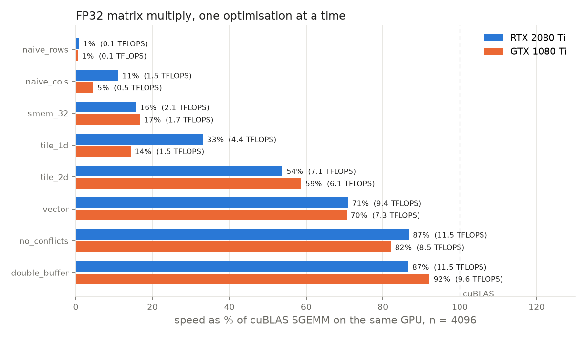

# Matrix multiply in CUDA, from naive to near cuBLAS

Single-precision matrix multiply (C = alpha A B + beta C, row-major) written eight times,
each version changing one thing, then a half-precision version on the tensor cores. Every
kernel is tested against cuBLAS and timed on an RTX 2080 Ti (Turing) and a GTX 1080 Ti
(Pascal), with the GPU's clock and power recorded for each measurement.

## In short

- **The best FP32 kernel reaches 87% of cuBLAS on the 2080 Ti** (11.5 against 13.3
  TFLOPS at n = 4096). On the 1080 Ti it reaches 92% at 4096 and slightly beats cuBLAS at
  8192 (9.59 against 9.25 TFLOPS).
- **The tensor-core kernel reaches 85% of cuBLAS's FP16 GEMM:** 47 against 55 TFLOPS on
  the 2080 Ti, four times the best FP32 kernel.
- **Four changes give nearly all the speed,** from 124 GFLOP/s to 11.5 TFLOPS on the
  2080 Ti:
  - **coalesced loads:** 12x;
  - **shared memory tiles** and then **register blocking** (each thread computing an 8 x 8
    block of C): 4.9x together;
  - **wide loads with a bank-conflict-free thread layout:** 1.6x.
- **Double buffering helps only on Pascal:** +12% on the 1080 Ti, nothing on the 2080 Ti.
  That fits the microbenchmarks, where Pascal's L1 and shared memory latencies are 85 and
  28 cycles against Turing's 32 and 22, so Pascal has more latency to hide.
- **Three registers halved a kernel's speed on Pascal.** At 67 registers per thread, the
  1D-tiled kernel fits only one 512-thread block per SM. The 2080 Ti compiles it to 64
  registers, fits two, and runs it three times faster.
- **Faster kernels run at a lower clock.** The 2080 Ti held 1,890 MHz for the naive kernel
  but dropped to 1,650 MHz under cuBLAS, at its power limit. Measured against the peak at
  each run's own clock, cuBLAS uses 92% of the FP32 units.

## How to run it

Needs an NVIDIA GPU, the CUDA toolkit and cuBLAS. One build covers Pascal and Turing.

```
make                      # build/gemm_test and build/gemm_bench
./build/gemm_test         # every kernel against cuBLAS; exits non-zero on a failure
./build/gemm_bench        # results/<gpu>/gemm.csv and kernels.csv, a few minutes
```

On a Slurm cluster, `jobs/slurm.sh` builds on the node, runs the tests (and stops if they
fail), runs the benchmark and copies `results/<gpu>/` back:

```
sbatch -A <account> -p <partition> -C 2080ti -o logs/%x-%j.out \
       --export=ALL,CUDA_MODULE=<cuda module> jobs/slurm.sh
```

The summary and the chart:

```
uv venv && uv pip install matplotlib pytest
.venv/bin/python analysis/report.py     # results/summary.md and figures/kernels.png
.venv/bin/python -m pytest              # 5 tests of the analysis
```

## The kernels

All in `src/kernels.cuh`. Words per multiply-add count the floats each multiply-add needs
from global and from shared memory. Each tile is loaded once and reused, so these follow
from the tile sizes.

| # | kernel | what changes | global words per FMA | shared words per FMA |
|---|---|---|---|---|
| 1 | `naive_rows` | one thread per element of C; neighbouring threads on neighbouring rows, so a warp reads 32 rows of A | 2 | - |
| 2 | `naive_cols` | neighbouring threads on neighbouring columns: B is read in order and the warp shares each element of A | 2 | - |
| 3 | `smem_32` | 32 x 32 tiles of A and B staged in shared memory | 1/16 | 2 |
| 4 | `tile_1d` | 64 x 64 block tiles, 8 outputs per thread down a column: one B value feeds 8 FMAs | 1/32 | 9/8 |
| 5 | `tile_2d` | 128 x 128 block tiles, an 8 x 8 block of C per thread: 16 shared reads feed 64 FMAs | 1/64 | 1/4 |
| 6 | `vector` | 16-byte global loads; A stored transposed in shared memory so a thread's 8 values are contiguous | 1/64 | 1/4 |
| 7 | `no_conflicts` | each thread's 8 x 8 split into four 4 x 4 blocks 64 apart, so a half-warp reads 256 contiguous bytes of shared memory | 1/64 | 1/4 |
| 8 | `double_buffer` | two shared buffers: the next tile is loaded into registers while the current one is used, one barrier per tile | 1/64 | 1/4 |
| 9 | `wmma` | FP16 inputs, FP32 results, on the tensor cores: 128 x 128 block tiles, 8 warps of 64 x 32, 16 x 16 x 16 WMMA fragments | | |

- **Sizes:** kernels 1 to 5 take any sizes. Kernels 6 to 8 need K and N to be multiples of
  4, for the 16-byte loads. Kernel 9 needs M and N to be multiples of 128 and K of 32, and
  computes C = A B only.
- **Edges:** loads past an edge read zeros. When beta is 0, C is not read, as BLAS
  specifies, so C may hold garbage.

## Results

Measured on a shared Slurm cluster, one GPU per job, CUDA 12.6. The clock was not locked;
each measurement records the SM clock and board power that NVML reports right after it.
GFLOP/s by square size (`results/summary.md` has every column):

### RTX 2080 Ti

| kernel | 512 | 1024 | 2048 | 4096 | 8192 | % of cuBLAS at 4096 | % of peak at its clock | registers | warps/SM |
|---|---|---|---|---|---|---|---|---|---|
| cuBLAS FP32 | 6,554 | 12,386 | 14,752 | 13,281 | 12,575 | 100% | 92% | | |
| naive_rows | 116 | 117 | 122 | 124 | | 1% | 1% | 52 | 32 |
| naive_cols | 1,625 | 1,697 | 1,549 | 1,469 | | 11% | 10% | 52 | 32 |
| smem_32 | 2,010 | 2,116 | 2,120 | 2,078 | 2,035 | 16% | 13% | 42 | 32 |
| tile_1d | 3,531 | 4,424 | 4,545 | 4,397 | 4,317 | 33% | 29% | 64 | 32 |
| tile_2d | 1,902 | 6,921 | 7,284 | 7,146 | 7,213 | 54% | 45% | 132 | 8 |
| vector | 2,607 | 9,021 | 9,846 | 9,411 | 9,114 | 71% | 61% | 117 | 16 |
| no_conflicts | 2,675 | 9,816 | 12,250 | 11,515 | 10,989 | 87% | 78% | 114 | 16 |
| double_buffer | 2,675 | 9,813 | 12,136 | 11,495 | 10,834 | 87% | 76% | 123 | 16 |
| cuBLAS FP16, tensor cores | 13,046 | 41,579 | 53,773 | 55,325 | 54,600 | 100% | 89% | | |
| wmma | 6,848 | 22,355 | 44,676 | 47,015 | 44,539 | 85% | 72% | 121 | 16 |

### GTX 1080 Ti

| kernel | 512 | 1024 | 2048 | 4096 | 8192 | % of cuBLAS at 4096 | % of peak at its clock | registers | warps/SM |
|---|---|---|---|---|---|---|---|---|---|
| cuBLAS FP32 | 3,974 | 8,066 | 10,670 | 10,408 | 9,248 | 100% | 83% | | |
| naive_rows | 58 | 75 | 75 | 61 | | 1% | 0% | 32 | 64 |
| naive_cols | 379 | 481 | 491 | 474 | | 5% | 4% | 32 | 64 |
| smem_32 | 1,372 | 1,768 | 1,756 | 1,742 | 1,711 | 17% | 13% | 28 | 64 |
| tile_1d | 1,124 | 1,381 | 1,501 | 1,488 | 1,458 | 14% | 11% | 67 | 16 |
| tile_2d | 1,725 | 3,795 | 5,878 | 6,110 | 5,999 | 59% | 47% | 128 | 16 |
| vector | 2,648 | 4,308 | 7,076 | 7,338 | 7,274 | 70% | 57% | 113 | 16 |
| no_conflicts | 3,013 | 6,374 | 9,194 | 8,540 | 8,592 | 82% | 70% | 109 | 16 |
| double_buffer | 4,096 | 8,004 | 10,325 | 9,585 | 9,594 | 92% | 83% | 122 | 16 |



### What each step shows

- **Coalescing:** the same arithmetic, with threads mapped along columns instead of rows,
  is 12x faster on the 2080 Ti and 6 to 8x on the 1080 Ti. Along rows, each warp-wide load of A
  touches 32 different rows.
- **Shared memory alone is not enough.** `smem_32` cuts global traffic 32-fold but still
  reads two shared-memory words per FMA, so shared memory bandwidth limits it at about 2
  TFLOPS on both cards.
- **Register blocking is the big jump.** With an 8 x 8 block per thread, 16 shared reads
  feed 64 FMAs. `tile_2d` reaches 7.1 TFLOPS on the 2080 Ti with only 8 warps per SM,
  since its 132 registers leave room for one 256-thread block.
- **Removing bank conflicts gives 16 to 22%.** In `vector`, neighbouring lanes read
  16-byte values 32 bytes apart, so in every group of 8 lanes two hit the same banks.
  Interleaving each thread's outputs (`no_conflicts`) makes the 8 lanes read 128
  contiguous bytes: 9.4 to 11.5 TFLOPS on the 2080 Ti, 7.3 to 8.5 on the 1080 Ti.
- **The occupancy cliff.** `tile_1d` is 64 registers on Turing and 67 on Pascal.
  Registers are handed out per warp in steps of 8 per thread, so 67 takes 72. Then
  72 x 512 threads x 2 blocks needs 73,728 registers, more than the SM's 65,536, so Pascal
  runs one block, 16 warps. It ends up slower than the simpler `smem_32`, which runs 64.
- **Small matrices don't fill the GPU.** At n = 512, the 128 x 128 tiles make 16 blocks
  for 68 SMs, so cuBLAS (which picks smaller tiles there) is 2.5x faster than the best
  kernel here. From n = 2048 on, the gap is 13 to 17% on the 2080 Ti.
- **The tensor-core kernel** has no double buffering and loads its tiles with plain 16-byte
  copies, so the 128 x 128 x 32 loop waits on memory between steps. It still reaches 47
  TFLOPS, 72% of the tensor-core peak at its clock.

## Tests

`build/gemm_test` runs 104 checks on the 2080 Ti and 100 on the 1080 Ti (no tensor cores
there):

- **Every FP32 kernel against cuBLAS on 11 shapes:** 1 x 1 x 1, odd sizes like 7 x 5 x 3
  and 33 x 65 x 17, sizes just past a tile (257 x 129 x 64), thin ones (64 x 1024 x 4)
  and 1024 cubed. These use beta = 0 with C filled with NaN, to prove C is not read. Three
  more cases use alpha = 1.5 and beta = -0.5.
- **The tensor-core kernel against cuBLAS's FP16 GEMM on 4 shapes,** with C pre-filled
  with NaN so a missed element shows up. It must also reject sizes it cannot handle.
- **The tolerance is the textbook bound for a dot product** (Higham, chapter 3). Any
  summation order is within about K u sum_k |a_k b_k| of the exact result (u = 2^-24), so
  two correct implementations differ by at most twice that. The sums of |a_k b_k| come from
  multiplying |A| by |B|. The worst error in any check was 16% of the bound. An indexing
  bug would be off by thousands of times the bound.

`pytest` covers the analysis. The peak formula reproduces the whitepaper's 13.4, 11.3 and
53.8 TFLOPS at the reference clocks, and the report runs on the saved results.

## Limits

- **No profiler.** The cluster restricts hardware counters to administrators, so the
  explanations above are derived from the code, the register counts and timings, not from
  measured stall reasons.
- **Clocks were not locked,** and the clock is read once per run, after it. Comparisons
  within a GPU are back to back, but the absolute TFLOPS move with the boost clock.
- **One tile shape per kernel, no autotuning.** cuBLAS picks among many kernels per size,
  which is most of its lead at small sizes.
- **The FP16 kernel is a straightforward WMMA version:** no asynchronous copies (those need
  Ampere) and no double buffering.
- **Square sizes only in the benchmark.** The tests cover rectangular shapes.

## Sources

- NVIDIA, "CUTLASS: Fast Linear Algebra in CUDA C++" (thread-block, warp and thread tiles;
  double buffering). https://developer.nvidia.com/blog/cutlass-linear-algebra-cuda/
- NVIDIA, CUDA C++ Programming Guide, release 12.6: warp matrix functions (WMMA).
  https://docs.nvidia.com/cuda/archive/12.6.0/pdf/CUDA_C_Programming_Guide.pdf
- NVIDIA, Turing GPU Architecture whitepaper, Table 1 (peak rates of both cards).
  https://images.nvidia.com/aem-dam/en-zz/Solutions/design-visualization/technologies/turing-architecture/NVIDIA-Turing-Architecture-Whitepaper.pdf
- N. J. Higham, Accuracy and Stability of Numerical Algorithms, 2nd ed., SIAM, 2002,
  chapter 3 (error bounds for inner products).
